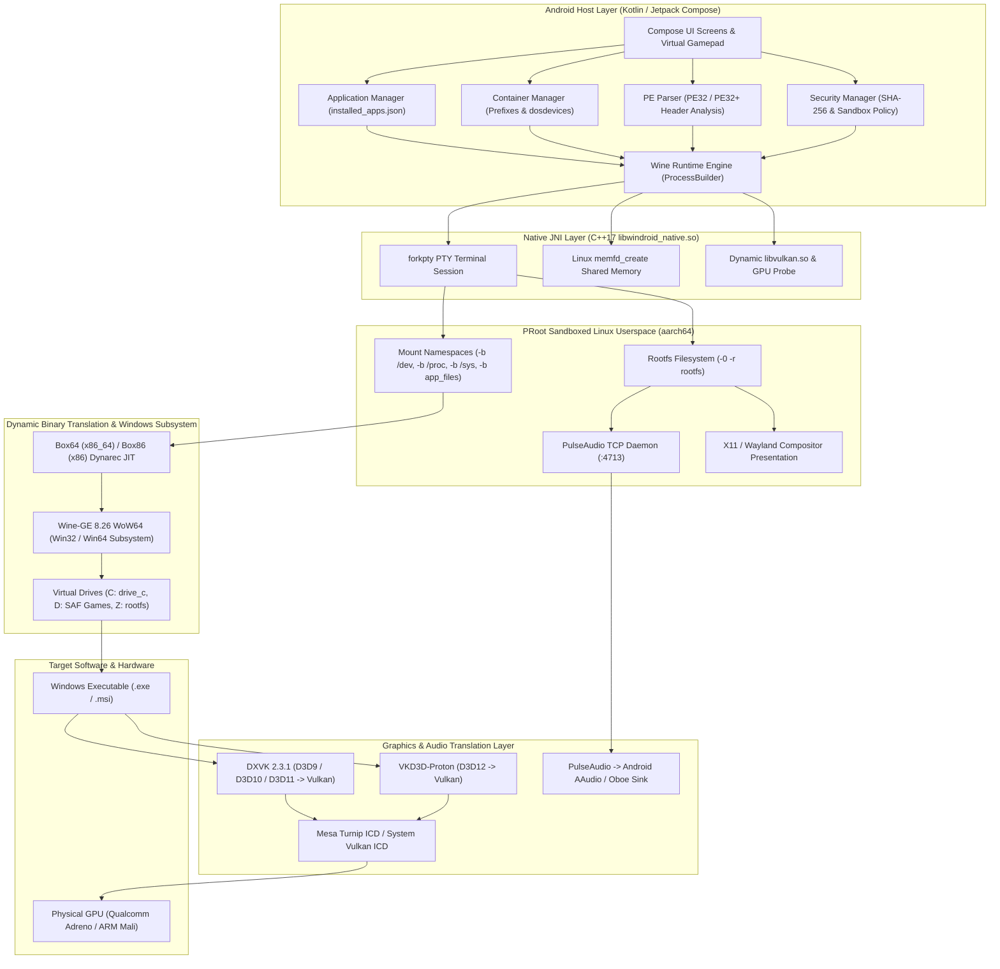
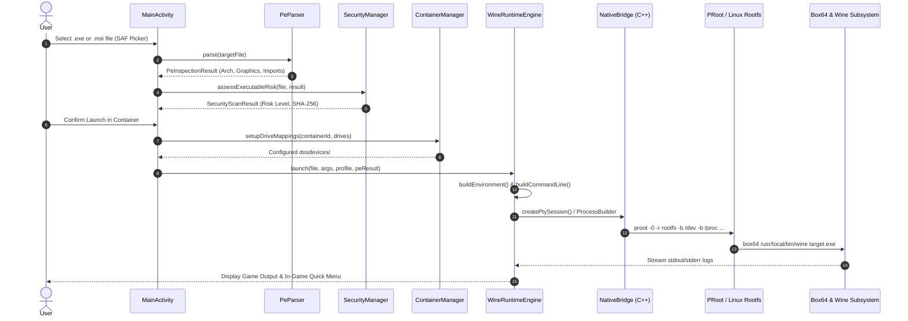

# WinDroid 🎮🚀

[](https://developer.android.com)
[-blue.svg)](https://developer.android.com/about/versions)
[-orange.svg)](https://developer.android.com/about/versions/14)
[](https://kotlinlang.org)
[](https://developer.android.com/jetpack/compose)
[](https://github.com/ptitSeb/box64)
[](file:///root/windroid/README.md#license)

> **WinDroid** is an open-source Android-native compatibility runtime that allows users to launch and run compatible Microsoft Windows (`.exe` and `.msi`) software directly on ARM64 Android devices without requiring a full Windows installation, dual boot, virtual machine hypervisor, or remote desktop PC.

---

## Table of Contents

- [1. Project Title](#1-project-title)
- [2. Project Overview](#2-project-overview)
- [3. Key Features](#3-key-features)
- [4. Technology Stack](#4-technology-stack)
- [5. Project Architecture](#5-project-architecture)
- [6. Project Structure](#6-project-structure)
- [7. How It Works](#7-how-it-works)
- [8. Prerequisites](#8-prerequisites)
- [9. Installation](#9-installation)
- [10. Configuration](#10-configuration)
- [11. Usage](#11-usage)
- [12. API Documentation](#12-api-documentation)
- [13. Database & Data Storage](#13-database--data-storage)
- [14. Authentication & Authorization](#14-authentication--authorization)
- [15. Testing & Verification](#15-testing--verification)
- [16. Security Considerations](#16-security-considerations)
- [17. Troubleshooting](#17-troubleshooting)
- [18. Known Limitations](#18-known-limitations)
- [19. Future Improvements](#19-future-improvements)
- [20. License](#20-license)
- [21. Author & Attribution](#21-author--attribution)

---

## 1. Project Title

**WinDroid** (`org.windroid`) — Version `0.1.0-alpha`  
*Native Windows Compatibility Runtime for ARM64 Android*

---

## 2. Project Overview

Running desktop Windows applications on modern mobile hardware historically required heavy virtual machine virtualization (such as QEMU) or remote PC streaming. **WinDroid** implements a lightweight, high-performance compatibility architecture conceptually modeled after **Winlator** and Valve's **Proton**.

Instead of emulating a full x86 PC motherboard, BIOS, and operating system, WinDroid orchestrates a multi-tier user-space translation stack:
1. **Dynamic Binary Translation**: [Box64](https://github.com/ptitSeb/box64) (x86_64) and [Box86](https://github.com/ptitSeb/box86) (x86 32-bit) translate x86 CPU instructions into native ARM64 instructions at runtime using an optimized JIT compiler (Dynarec).
2. **API Call Translation**: [Wine](https://www.winehq.org) (specifically Wine-GE WoW64) intercepts Windows Win32/Win64 system and kernel calls, translating them into standard POSIX/Linux system calls.
3. **Graphics Translation**: [DXVK](https://github.com/doitsujin/dxvk) and [VKD3D-Proton](https://github.com/HansKristian-Work/vkd3d-proton) translate Microsoft Direct3D 9, 10, 11, and 12 draw calls into native Vulkan command buffers executed directly on Android mobile GPUs (via Mesa Turnip or system Vulkan ICD).
4. **Sandboxed Rootfs**: Execution is contained within a user-space [PRoot](https://proot-me.github.io) sandbox, enforcing Android Scoped Storage compliance without requiring device root access.
5. **Modern Handheld Interface**: A native Android UI built with Jetpack Compose and Material 3 provides game library management, container customization, performance telemetry, virtual on-screen gamepads, and real-time PE inspection.

---

## 3. Key Features

- **Real-Time Portable Executable (PE) Inspector**:
  - Automatically parses DOS (`IMAGE_DOS_HEADER`), COFF, and Optional Headers of selected `.exe` and `.msi` files.
  - Detects target architecture (`IMAGE_FILE_MACHINE_I386`, `AMD64`, or native `ARM64`), bitness, and subsystem (GUI vs. Console).
  - Traverses the Import Directory Table (`IMAGE_IMPORT_DESCRIPTOR`) to discover imported graphics APIs (`d3d9.dll`, `d3d10core.dll`, `d3d11.dll`, `d3d12.dll`, `opengl32.dll`, `vulkan-1.dll`) and .NET runtimes (`mscoree.dll`).
  - Automatically recommends the optimal Wine prefix architecture (`win32` vs `win64`) and Box64 Dynarec performance preset.

- **Multi-Container Prefix Isolation**:
  - Supports creating, configuring, and deleting distinct Wine containers (`.wine` prefixes) under Android scoped app storage.
  - Isolated virtual drive mapping (`dosdevices/`):
    - `C:` mapped to container private system drive (`drive_c/windows`, `Program Files`, `users/windroid`).
    - `D:` mapped to user-selected external storage or Android Storage Access Framework (SAF) games folder.
    - `Z:` mapped to the read-only Linux rootfs system libraries.
  - Prevents unintended cross-contamination or unauthorized access to private Android device data.

- **Hardware-Accelerated Vulkan Graphics Pipeline**:
  - Native support for **Mesa Turnip** (Adreno Vulkan ICD for Qualcomm Snapdragon 6xx/7xx/8xx series).
  - Support for **System Native Vulkan** (`libvulkan.so`) for MediaTek Dimensity, Samsung Exynos, and Google Tensor chipsets.
  - Support for **Mesa Panfrost** (ARM Mali GPUs) and **Mesa Zink** (OpenGL over Vulkan).
  - Virtualized **VirGL** and software **LLVMpipe** rendering fallbacks.
  - DXVK 2.3.1 integration translating Direct3D 9/10/11 into Vulkan command buffers with state caching and async pipeline compilation.

- **Box64 / Box86 Dynarec Tuning Presets**:
  - **Safe (High Compatibility)**: Strict IEEE floating-point flags (`FASTNAN=0`, `SAFEFLAGS=1`, `CALLRET=0`).
  - **Balanced (Recommended)**: Balanced performance for mainstream games (`FASTNAN=1`, `BIGBLOCK=1`, `CALLRET=1`).
  - **Aggressive Performance (Peak FPS)**: Maximum instruction unrolling and fast math (`FASTNAN=1`, `FASTROUND=1`, `BIGBLOCK=2`, `SAFEFLAGS=0`, `FORWARD=256`).

- **Handheld Input & Touch Controls**:
  - **Relative Trackpad**: Accelerated mouse cursor navigation with tap-to-left-click and two-finger right-click.
  - **Direct Touchscreen**: 1:1 screen mapping for strategy games, point-and-click adventures, and installers.
  - **Virtual Gamepad Overlay**: Fully customizable on-screen touch overlay featuring dual analog thumbsticks with deadzone calibration, D-Pad, ABXY cluster, and shoulder buttons (L1, L2, R1, R2).
  - **Physical Gamepad Pass-Through**: Automatic mapping of Bluetooth and USB HID controllers to Windows XInput.

- **Application Manager & Library**:
  - Manage game shortcuts, custom launch arguments, resolution overrides, and categories (`Games`, `Productivity`, `Utilities`, `Media`).
  - Persistent playtime counter tracking total session hours and last played timestamps.

- **Pre-Execution Security Policy**:
  - Computes SHA-256 binary checksums prior to launch.
  - Warns users when executing binaries directly from the Android `Downloads` directory.
  - Blocks execution of NT kernel-mode drivers (`.sys`) and attempts to overwrite core protected Wine binaries (`ntdll.dll`, `kernel32.dll`, `wineboot.exe`).
  - Requires explicit user consent before untrusted binaries execute.

- **Live Performance & Telemetry HUD**:
  - In-game slide-out quick menu (`InGameQuickMenu.kt`) allowing instant FPS overlay toggling, input mode switching, soft keyboard summoning, and emergency Wine process termination.
  - Dedicated telemetry dashboard displaying live FPS, frametimes, RAM allocation, CPU load, and GPU driver status.

---

## 4. Technology Stack

### Languages & Frameworks

| Component | Technology | Version / Specification |
|---|---|---|
| **Android Host App** | Kotlin | 1.9.23 |
| **Android Target / Min SDK** | Android SDK | Target: API 34 (Android 14) / Min: API 28 (Android 9.0) |
| **UI Framework** | Jetpack Compose / Material 3 | Compose BOM 2024.04.00, Material 3 1.2.1 |
| **Navigation** | Navigation Compose | 2.7.7 |
| **Async & Concurrency** | Kotlinx Coroutines Android | 1.8.0 |
| **Native JNI Engine** | C++ | C++17 (Clang / GCC) |
| **Native Build Tool** | CMake / Android NDK | CMake 3.22.1 / NDK 26.1.10909125 |
| **Container Scripts** | Bash / POSIX Shell | Shell scripts for rootfs boot & DXVK deployment |
| **Test Suite & Scanner** | Python | Python 3.10+ (Standard library `unittest`, `struct`) |
| **Build Automation** | Gradle / AGP | Gradle 8.4+ (Wrapper 8.7) / AGP 8.3.2 |

### Emulation & Translation Core

| Subsystem | Upstream Project | License | Purpose |
|---|---|---|---|
| **PRoot** | PRoot Project | GNU GPL v2.0 | Chroot and mount namespace virtualization without device root |
| **Wine** | WineHQ / Wine-GE | GNU LGPL v2.1+ | Win32/Win64 Windows API implementation |
| **Box64** | ptitSeb / Box64 | MIT License | 64-bit x86_64 to ARM64 JIT dynamic binary translator |
| **Box86** | ptitSeb / Box86 | MIT License | 32-bit x86 to ARM32/ARM64 JIT dynamic binary translator |
| **DXVK** | doitsujin / DXVK | zlib / libpng | Direct3D 9, 10, 11 to Vulkan translation layer |
| **VKD3D-Proton** | Valve / VKD3D-Proton | GNU LGPL v2.1 | Direct3D 12 to Vulkan translation layer |
| **Mesa Turnip** | Mesa3D Project | MIT / X11 | Open-source Vulkan driver for Qualcomm Adreno GPUs |
| **PulseAudio** | FreeDesktop PulseAudio | GNU LGPL v2.1+ | Low-latency audio server over local TCP socket (`:4713`) |

---

## 5. Project Architecture

The following diagram illustrates the multi-tier runtime execution pipeline from the user interface down to physical hardware:



### Runtime Execution Sequence



---

## 6. Project Structure

```
windroid/
├── .gitignore                             # Git ignore rules for Android, C++, Python, Gradle
├── ARCHITECTURE.md                        # Technical subsystem bridge documentation
├── BUILD.md                               # Comprehensive build & release packaging guide
├── README.md                              # Main project documentation (this file)
├── build.gradle.kts                       # Root project build configuration
├── gradle.properties                      # JVM memory flags and AndroidX properties
├── settings.gradle.kts                    # Project naming and Maven repository endpoints
├── gradlew / gradlew.bat                  # Gradle wrapper scripts (v8.7)
├── gradle/
│   ├── libs.versions.toml                 # Version catalog (dependencies & plugins)
│   └── wrapper/
│       ├── gradle-wrapper.jar
│       └── gradle-wrapper.properties
├── app/
│   ├── build.gradle.kts                   # Android module configuration, NDK & CMake linkage
│   └── src/
│       └── main/
│           ├── AndroidManifest.xml        # Permissions, application metadata & file filters
│           ├── cpp/                       # Native C++17 JNI implementation
│           │   ├── CMakeLists.txt         # Native library build script
│           │   ├── windroid_native.h      # Hardware capability struct & JNI headers
│           │   └── windroid_native.cpp    # forkpty, memfd, Vulkan probe, input event sink
│           ├── java/org/windroid/
│           │   ├── MainActivity.kt        # Compose NavHost navigation & SAF file handler
│           │   ├── WinDroidApplication.kt # Application lifecycle & subsystem singleton setup
│           │   ├── core/
│           │   │   ├── application/       # ApplicationManager.kt & InstalledApp model
│           │   │   ├── container/         # ContainerManager.kt & ContainerProfile.kt
│           │   │   ├── graphics/          # GraphicsDriverConfig.kt & DisplayResolution
│           │   │   ├── input/             # InputManager.kt & MouseMode definitions
│           │   │   ├── nativebridge/      # NativeBridge.kt (JNI interface to libwindroid_native.so)
│           │   │   ├── pe/                # PeParser.kt & PeInspectionResult.kt
│           │   │   ├── runtime/           # WineRuntimeEngine.kt & RuntimeManager.kt
│           │   │   └── security/          # SecurityManager.kt & RiskLevel evaluation
│           │   └── ui/
│           │       ├── components/
│           │       │   ├── InGameQuickMenu.kt       # Slide-out quick overlay during execution
│           │       │   └── VirtualGamepadOverlay.kt # Dual analog sticks, D-Pad, ABXY buttons
│           │       ├── screens/           # 12 Jetpack Compose UI screens
│           │       │   ├── AboutScreen.kt
│           │       │   ├── AddAppWizardScreen.kt
│           │       │   ├── ContainerEditScreen.kt
│           │       │   ├── ContainersScreen.kt
│           │       │   ├── GraphicsSettingsScreen.kt
│           │       │   ├── HomeScreen.kt
│           │       │   ├── InputSettingsScreen.kt
│           │       │   ├── InstalledAppsScreen.kt
│           │       │   ├── LogViewerScreen.kt
│           │       │   ├── PeInspectorScreen.kt
│           │       │   ├── PerformanceMonitorScreen.kt
│           │       │   └── RuntimeManagerScreen.kt
│           │       └── theme/
│           │           └── Theme.kt       # Dark handheld color scheme
│           └── res/
│               └── values/
│                   └── strings.xml        # Application strings
├── runtime/
│   ├── windroid_boot.sh                   # In-container bootstrapper & driver config script
│   └── install_dxvk.sh                    # DXVK/VKD3D DLL installation script for prefixes
└── tools/
    ├── pe_scanner.py                      # Standalone CLI PE inspector tool
    ├── test_pe_scanner.py                 # Unit tests for PE32/PE32+ parsing & DirectX detection
    ├── test_container_manager.py          # Unit tests for container prefixes & dosdevices
    ├── test_application_manager.py        # Unit tests for app registration & JSON persistence
    ├── test_security_manager.py           # Unit tests for SHA-256 & path isolation
    ├── test_native_library.py             # Unit tests for native C++ compilation & JNI symbols
    └── run_all_tests.py                   # Master test harness executing all 5 suites + PRoot test
```

---

## 7. How It Works

### Step 1: Binary Intake and PE Analysis
When a user opens a `.exe` or `.msi` file from Android storage or a file manager, `MainActivity` copies the binary stream to a temporary cache location and invokes [`PeParser.parse()`](file:///root/windroid/app/src/main/java/org/windroid/core/pe/PeParser.kt).
1. `PeParser` reads the initial 64-byte DOS header to verify `0x5A4D` (`MZ`).
2. It reads offset `0x3C` (`e_lfanew`) to locate the 4-byte PE signature `0x00004550` (`PE\0\0`).
3. It evaluates the 20-byte COFF header machine type:
   - `0x014C`: Intel 386 (32-bit x86) -> Assigns **Box86** and `win32` Wine architecture.
   - `0x8664`: AMD64 (64-bit x86_64) -> Assigns **Box64** and `win64` Wine architecture.
   - `0xAA64`: ARM64 (AArch64) -> Flags binary as native ARM64 without dynamic translation.
4. It reads the Optional Header data directory to locate the Import Directory Table (`IMAGE_IMPORT_DESCRIPTOR`). It parses thunk records and extracts all imported DLL strings. If `d3d11.dll` or `dxgi.dll` is present, DXVK is automatically selected.

### Step 2: Container Initialization & Drive Isolation
[`ContainerManager`](file:///root/windroid/app/src/main/java/org/windroid/core/container/ContainerManager.kt) prepares the isolated prefix environment:
- Creates the prefix directory at `$APP_FILES/containers/<container_id>/.wine`.
- Builds standard Windows directory scaffolding: `drive_c/windows/system32`, `syswow64`, `Program Files`, `Program Files (x86)`, and user profile folders.
- Configures virtual drive pointers inside `dosdevices/`:
  - `c:` -> symlinked to `../drive_c`
  - `d:` -> symlinked to `$APP_FILES/storage/Games` (or user-authorized SAF directory)
  - `z:` -> points to sandboxed Linux system libraries

### Step 3: Security & Sandboxing Verification
[`SecurityManager`](file:///root/windroid/app/src/main/java/org/windroid/core/security/SecurityManager.kt) assesses pre-execution risk:
- Computes SHA-256 fingerprint for identity verification.
- Raises a warning if the file is located in the Android `Downloads/` directory.
- Blocks execution if the PE subsystem corresponds to an NT kernel-mode device driver (`subsystem == 1`).
- Validates canonical path isolation (`validatePathIsolation`) ensuring that no executable or argument attempts path traversal outside authorized container roots.

### Step 4: PRoot Sandbox & Wine Launch
[`WineRuntimeEngine`](file:///root/windroid/app/src/main/java/org/windroid/core/runtime/WineRuntimeEngine.kt) synthesizes the execution command and environment variable map:
```bash
proot \
  -0 \
  -r /data/user/0/org.windroid/files/rootfs \
  -b /dev \
  -b /proc \
  -b /sys \
  -b /data/user/0/org.windroid/files \
  -b /data/user/0/org.windroid/files/storage/Games \
  -w /data/user/0/org.windroid/files/storage/Games \
  /usr/local/bin/box64 \
  /usr/local/bin/wine \
  target.exe
```
The process runs inside PRoot, intercepts x86/x64 instructions via Box64 Dynarec, redirects Direct3D calls through DXVK into Vulkan, and renders output frames to the display while routing PulseAudio audio streams to port `4713`.

---

## 8. Prerequisites

### Development & Build Machine
- **Operating System**: Linux (Ubuntu 20.04/22.04 LTS or Debian 11/12 recommended) or macOS (Apple Silicon / Intel).
- **Java Development Kit (JDK)**: OpenJDK 17 (`openjdk-17-jdk`) or OpenJDK 21.
- **Android SDK**: Platform API Level 34 (`platforms;android-34`).
- **Android Build Tools**: `build-tools;34.0.0`.
- **Android NDK**: Version `26.1.10909125` (`ndk;26.1.10909125`).
- **CMake**: Version `3.22.1` (`cmake;3.22.1`).
- **Python**: Version `3.10` or newer (for test harness and PE scanner).
- **C++ Compiler**: `g++` or `clang++` supporting C++17 (for standalone native bridge tests).

### Target Android Device
- **Architecture**: 64-bit ARM (`arm64-v8a` / `aarch64`). 32-bit only ARM devices are not supported.
- **Operating System**: Android 9.0 (API Level 28) or newer (Android 12, 13, 14 recommended).
- **RAM**: Minimum 4 GB RAM (6 GB to 12 GB strongly recommended for 3D gaming).
- **GPU & Driver**:
  - Best: Qualcomm Snapdragon SoC with Adreno 6xx, 7xx, or 8xx GPU (supports Mesa Turnip driver).
  - Supported: MediaTek Dimensity, Samsung Exynos, Google Tensor with Vulkan 1.2+ hardware support.

---

## 9. Installation

### 1. Clone the Repository
```bash
git clone git@github.com:H4R5787/WinDroid.git
cd WinDroid
```

### 2. Configure Environment Variables
Set `ANDROID_HOME` and `JAVA_HOME` in your shell configuration (`~/.bashrc` or `~/.zshrc`):
```bash
export ANDROID_HOME=$HOME/Android/Sdk
export JAVA_HOME=/usr/lib/jvm/java-17-openjdk-arm64
export PATH=$PATH:$ANDROID_HOME/cmdline-tools/latest/bin:$ANDROID_HOME/platform-tools
```

### 3. Configure Local Properties
Create or edit `local.properties` in the project root:
```properties
sdk.dir=/root/Android/Sdk
cmake.dir=/root/Android/Sdk/cmake/3.22.1
ndk.dir=/root/Android/Sdk/ndk/26.1.10909125
```

### 4. Build Debug APK
Assemble the debug APK using Gradle:
```bash
./gradlew assembleDebug
```
The resulting APK will be generated at:
```
app/build/outputs/apk/debug/app-debug.apk
```

### 5. Install on Connected Android Device
Ensure USB Debugging is enabled on your device:
```bash
adb devices
adb install -r app/build/outputs/apk/debug/app-debug.apk
```

### 6. Build Signed Release APK
To assemble an optimized release APK:
```bash
./gradlew assembleRelease
```
The output APK will be placed at:
```
app/build/outputs/apk/release/app-release.apk
```

---

## 10. Configuration

WinDroid provides granular configuration across container profiles, Box64 dynarec options, graphics drivers, and environment variables.

### Box64 Dynarec Tuning Presets

| Environment Variable | Safe Preset | Balanced (Default) | Aggressive Preset | Description |
|---|---|---|---|---|
| `BOX64_DYNAREC` | `1` | `1` | `1` | Enables Box64 JIT Dynamic Recompiler |
| `BOX64_DYNAREC_FASTNAN` | `0` | `1` | `1` | Fast NaN generation (avoids strict IEEE checks) |
| `BOX64_DYNAREC_FASTROUND` | `0` | `0` | `1` | Fast float rounding mode |
| `BOX64_DYNAREC_BIGBLOCK` | `0` | `1` | `2` | Multi-block JIT aggregation (0=none, 1=normal, 2=large) |
| `BOX64_DYNAREC_SAFEFLAGS` | `1` | `1` | `0` | Emulate CPU arithmetic flags strictly |
| `BOX64_DYNAREC_CALLRET` | `0` | `1` | `1` | Optimize call/return address stack caching |
| `BOX64_DYNAREC_FORWARD` | `0` | `0` | `256` | Look-ahead basic block unrolling count |

### Graphics Backends & Driver Selection

Configured via Container Settings or Graphics Settings Screen:
- `turnip` (**Mesa Turnip**): Direct Adreno Vulkan ICD via `/usr/share/vulkan/icd.d/freedreno_icd.aarch64.json`. Recommended for Snapdragon devices.
- `system` (**System Vulkan**): Native Android `libvulkan.so` loader. Best compatibility for MediaTek Dimensity and Samsung Exynos.
- `panfrost` (**Mesa Panfrost**): Vulkan acceleration for ARM Mali G-series GPUs.
- `virgl` (**VirGL Virtualized OpenGL**): OpenGL fallback through Virpipe bridge.
- `llvmpipe` (**LLVMpipe CPU Software**): Pure CPU software rasterizer for debugging.

### Standard Wine & DXVK Environment Variables

```properties
# Wine Configuration
WINEPREFIX=/data/user/0/org.windroid/files/containers/<id>/.wine
WINEARCH=win64
WINEDEBUG=-all
WINEESYNC=0
WINEDLLOVERRIDES=mscoree,mshtml=;d3d9,d3d10core,d3d11,dxgi=n,b

# Display & Audio
DISPLAY=:0
PULSE_SERVER=127.0.0.1:4713
GALLIUM_DRIVER=zink
MESA_LOADER_DRIVER_OVERRIDE=zink

# DXVK Direct3D Translation
DXVK_STATE_CACHE=1
DXVK_LOG_LEVEL=info
DXVK_HUD=fps,devinfo
```

---

## 11. Usage

### 1. Launching via Add Application Wizard
1. Open the WinDroid application on your Android device.
2. From the **Home** dashboard, tap **"Browse EXE"** or the **"+"** action icon.
3. Use the system file picker to select a Windows `.exe` or `.msi` file.
4. WinDroid automatically parses the binary and shows the **Executable Compatibility Report**:
   - Machine architecture (e.g. `AMD64 / x86_64`)
   - Detected graphics requirement (e.g. `DirectX 10 / 11 (D3D10/D3D11)`)
   - Recommended translator (`DXVK (Vulkan)`)
   - Recommended Wine prefix bitness (`WIN64`)
5. Configure the Application Title, target container, Box64 dynarec preset, and graphics driver.
6. Acknowledge the security sandbox notice and tap **"Launch Now"** or **"Save to Library"**.

### 2. Managing Containers
1. Tap **"Containers"** from the navigation bar.
2. View existing containers (default is `Primary 64-bit Wine Container`).
3. Tap **"+ New"** to create an additional container (e.g. a dedicated 32-bit container for retro games).
4. Tap **"Configure"** to open the 4-tab Container Editor:
   - **General**: Container name, Wine architecture (`win64` / `win32`), display resolution (`1280x720`, `1920x1080`, `Native`).
   - **Graphics**: GPU driver selection (Turnip, System Vulkan, Panfrost), DXVK performance HUD toggle.
   - **Box64 Dynarec**: Performance preset selection (`Safe`, `Balanced`, `Aggressive`).
   - **Drives & Storage**: Inspect virtual drive allocations (`C:`, `D:`, `Z:`).

### 3. In-Game Overlay Controls
During active execution of a Windows application:
- Access the **In-Game Quick Menu** to toggle the DXVK Performance HUD, switch mouse modes (`Relative Trackpad` vs `Direct Touch`), summon the Android soft keyboard, or trigger an emergency force-stop.
- Enable the **Virtual Gamepad Overlay** to render dual analog sticks, D-Pad, ABXY buttons, and shoulder bumpers directly over the game canvas.

---

## 12. API Documentation

WinDroid is an offline Android client application and does not expose external HTTP/REST network endpoints. However, it exposes modular internal APIs across its native C++ bridge and core Kotlin subsystems.

### Native C++ JNI Interface (`NativeBridge.kt` / `windroid_native.cpp`)

| Function Signature | Description |
|---|---|
| `getCpuArchitecture(): String` | Direct CPU architecture detection returning `aarch64 (ARM64 64-bit)`, `armv7l`, `x86_64`, or `i386`. |
| `checkVulkanSupport(): Int` | Probes dynamic loading of `libvulkan.so` and `vkGetInstanceProcAddr`. Returns Vulkan API version integer (e.g. `0x00403000` for Vulkan 1.3). |
| `detectGpuRenderer(): String` | Inspects `/dev/kgsl-3d0` and `/sys/class/kgsl/kgsl-3d0/gpu_model` for Adreno, `/dev/mali0` for Mali, or returns fallback. |
| `createPtySession(cmdArgs, envVars, workDir): Int` | Calls POSIX `forkpty()` to spawn an isolated pseudo-terminal execution session with non-blocking master file descriptor. |
| `sendInputEvent(eventType, code, value): Int` | Dispatches low-latency mouse, keyboard, or gamepad events directly into the native runtime input pipe. |
| `createSharedBuffer(name, size): Int` | Invokes Linux syscall `__NR_memfd_create` with `MFD_CLOEXEC` to allocate shared memory for zero-copy frame presentation. |
| `closePtySession(ptyFd): Int` | Closes the POSIX master file descriptor and cleans up associated child process sessions. |

### Core Kotlin Subsystem APIs

#### 1. Portable Executable Parser (`PeParser.kt`)
```kotlin
object PeParser {
    fun parse(file: File): PeInspectionResult
    fun parseBytes(data: ByteArray, fileName: String): PeInspectionResult
}
```
Returns a `PeInspectionResult` object detailing `isValidPe`, `architecture` (`PeArchitecture`), `is64Bit`, `subsystem` (`PeSubsystem`), `sections`, `importedDlls`, `detectedGraphics` (`GraphicsBackendRequirement`), and `recommendedWinePrefixArch`.

#### 2. Container Manager (`ContainerManager.kt`)
```kotlin
class ContainerManager(baseFilesDir: File) {
    fun createContainer(profile: ContainerProfile): ContainerProfile
    fun deleteContainer(containerId: String): Boolean
    fun listContainers(): List<String>
    fun setupDriveMappings(containerId: String, drives: List<DriveMapping>)
    fun getWinePrefixDir(containerId: String): File
}
```

#### 3. Wine Runtime Engine (`WineRuntimeEngine.kt`)
```kotlin
class WineRuntimeEngine(rootfsDir: File, appFilesDir: File) {
    fun launch(targetExe: File, exeArgs: List<String>, profile: ContainerProfile, peInfo: PeInspectionResult?): Boolean
    fun terminate(): Boolean
    fun isRunning(): Boolean
    fun getLogs(): List<RuntimeLogEntry>
    fun addLogListener(listener: (RuntimeLogEntry) -> Unit)
}
```

#### 4. Security Manager (`SecurityManager.kt`)
```kotlin
class SecurityManager(appFilesDir: File) {
    fun assessExecutableRisk(file: File, peResult: PeInspectionResult?): SecurityScanResult
    fun validatePathIsolation(path: String, allowedPrefixDir: File, mappedDrives: List<String>): Boolean
}
```

---

## 13. Database & Data Storage

WinDroid does not use a relational SQL database (e.g. SQLite or Room). Application persistence is maintained through structured JSON serialization on internal scoped app storage.

### Persistent Filesystem Map

```
/data/user/0/org.windroid/files/
├── installed_apps.json                     # Application registry & playtime tracking
├── containers/                             # Wine prefix container root
│   ├── default-x64/
│   │   └── .wine/
│   │       ├── dosdevices/
│   │       │   ├── c: -> ../drive_c
│   │       │   ├── d: -> /storage/emulated/0/...
│   │       │   └── z: -> /rootfs
│   │       ├── drive_c/
│   │       │   ├── Program Files/
│   │       │   ├── Program Files (x86)/
│   │       │   ├── windows/
│   │       │   │   ├── system32/
│   │       │   │   └── syswow64/
│   │       │   └── users/windroid/
│   │       ├── system.reg
│   │       └── user.reg
│   └── <custom_container_id>/
├── rootfs/                                 # PRoot Linux userspace environment (aarch64)
│   ├── usr/
│   │   ├── bin/proot
│   │   ├── local/bin/box64
│   │   ├── local/bin/wine
│   │   └── share/dxvk/
└── storage/
    └── Games/                              # Default internal games repository
```

### Schema of `installed_apps.json`
```json
[
  {
    "id": "c5f1a238-7821-49b0-9114-1e56b46ef012",
    "title": "Half-Life 2",
    "exePath": "/data/user/0/org.windroid/files/storage/Games/hl2.exe",
    "arguments": "-novid -fullscreen",
    "containerId": "default-x64",
    "architecture": "x86_64",
    "graphicsBackend": "TURNIP_ADRENO",
    "resolution": "1280x720",
    "box64Preset": "BALANCED",
    "dxvkEnabled": true,
    "vkd3dEnabled": false,
    "showFpsCounter": true,
    "installTimestamp": 1726000000000,
    "lastPlayedTimestamp": 1726500000000,
    "totalPlayTimeSeconds": 5400,
    "category": "Games"
  }
]
```

---

## 14. Authentication & Authorization

### Application-Level Authentication
- **Not applicable**: WinDroid is an offline local tool. It requires no login, user accounts, passwords, API keys, or cloud authentication tokens.

### Android System Permissions

| Permission | Manifest Level | Purpose |
|---|---|---|
| `android.permission.WAKE_LOCK` | Normal | Prevents the CPU from entering low-power sleep during active emulation. |
| `android.permission.FOREGROUND_SERVICE` | Normal | Allows the emulation engine and audio daemon to persist during background tasks. |
| `android.permission.RECORD_AUDIO` | Dangerous / Runtime | Required for PulseAudio bidirectional audio routing and microphone pass-through. |
| `android.permission.INTERNET` | Normal | Allows network-enabled Windows software to connect to local/remote networks. |
| `android.permission.ACCESS_NETWORK_STATE` | Normal | Monitors network connectivity for online software. |
| `READ_EXTERNAL_STORAGE` | Max SDK 32 | Legacy storage access for Android 12 and below. |
| `WRITE_EXTERNAL_STORAGE` | Max SDK 29 | Legacy storage write access for Android 10 and below. |

### Sandboxing & Path Authorization
Access to files outside the private application sandbox is strictly gated through the **Android Storage Access Framework (SAF)** via `ActivityResultContracts.GetContent()`. Windows binaries never receive unrestricted access to the Android root filesystem (`/data`, `/system`) or unselected shared media directories.

---

## 15. Testing & Verification

WinDroid features an automated test harness located in the [`tools/`](file:///root/windroid/tools) directory. The test harness executes 5 comprehensive subsystem test suites in addition to a host PRoot compatibility check.

### Running the Test Suite
Execute the test runner from the repository root:
```bash
python3 tools/run_all_tests.py
```

### Verification Matrix

```
############################################################
       WinDroid Automated Subsystem Test Harness            
############################################################

============================================================
  RUNNING TEST SUITE: PE Parser & Compatibility Engine
============================================================
  ✓ test_32bit_directx9_binary: Synthesizes PE32 (i386) binary with d3d9.dll import.
  ✓ test_64bit_directx11_binary: Synthesizes PE32+ (AMD64) binary with d3d11.dll import.
  ✓ test_native_arm64_binary: Synthesizes ARM64 PE binary with ntdll.dll import.
  ✓ test_invalid_file: Verifies corrupt header handling.
--> PE Parser & Compatibility Engine: PASSED

============================================================
  RUNNING TEST SUITE: Container Manager & Sandboxing
============================================================
  ✓ test_container_creation_and_filesystem: Verifies drive_c scaffolding and dosdevices symlinks.
  ✓ test_proot_command_assembly: Validates synthesis of PRoot arguments and Box64 flags.
  ✓ test_container_deletion: Verifies recursive prefix purge.
--> Container Manager & Sandboxing: PASSED

============================================================
  RUNNING TEST SUITE: Application Manager & Persistence
============================================================
  ✓ test_app_registration_and_persistence: Verifies JSON roundtrip persistence.
  ✓ test_playtime_tracking: Validates cumulative seconds calculation and timestamps.
  ✓ test_app_deletion: Verifies shortcut deletion from registry.
--> Application Manager & Persistence: PASSED

============================================================
  RUNNING TEST SUITE: Security Policy & Sandboxing
============================================================
  ✓ test_sha256_checksum: Verifies cryptographic hash computation.
  ✓ test_downloads_folder_risk: Tests quarantine warnings for downloaded files.
  ✓ test_kernel_driver_blocked: Verifies blocking of NT driver subsystem binaries.
  ✓ test_path_isolation_and_traversal_prevention: Tests containment against ../../ escapes.
--> Security Policy & Sandboxing: PASSED

============================================================
  RUNNING TEST SUITE: Native C++ JNI Bridge & Compilation
============================================================
  ✓ test_library_compiled_successfully: Compiles windroid_native.cpp with C++17.
  ✓ test_exported_jni_symbols: Validates presence of all 7 required JNI symbols via nm.
--> Native C++ JNI Bridge & Compilation: PASSED

============================================================
  CHECKING HOST PROOT SANDBOX COMPATIBILITY
============================================================
--> Host PRoot Execution: PASSED (Kernel sandbox supported)

############################################################
                   TEST SUMMARY RESULTS                    
############################################################
  ✓ PASS   | PE Header & Compatibility Engine
  ✓ PASS   | Container Manager & Sandboxing
  ✓ PASS   | Application Manager & Persistence
  ✓ PASS   | Security Policy & Sandboxing
  ✓ PASS   | Native C++ JNI Bridge & Compilation
  ✓ PASS   | Host PRoot Sandbox Compatibility
############################################################

🎉 ALL TESTS PASSED! WinDroid subsystems are functional.
```

### Running Standalone PE Scanner CLI
To inspect any Windows binary directly on your development terminal:
```bash
python3 tools/pe_scanner.py path/to/application.exe
```

---

## 16. Security Considerations

1. **Untrusted Binary Execution**:
   - Windows `.exe` files from the internet can contain malicious x86/x64 shellcode or ransomware. WinDroid isolates executables inside PRoot and mounts only the container prefix and designated games folder.
   - Files detected in the `Downloads/` directory trigger a prominent quarantine warning requiring explicit user consent before launch.

2. **No Device Root Required**:
   - WinDroid operates entirely in standard Android user space. It does not require Magisk, KernelSU, or root permissions.

3. **Driver & Anti-Cheat Restrictions**:
   - Kernel-mode drivers (`.sys`) and ring-0 anti-cheat software (such as Easy Anti-Cheat, BattlEye, or Riot Vanguard) are blocked by the Security Manager because they cannot safely execute in user-space Wine.

4. **Scoped Storage Compliance**:
   - WinDroid complies with Android 14 Scoped Storage requirements by utilizing the Storage Access Framework (SAF), ensuring that Windows software cannot read user photos, contacts, or documents.

---

## 17. Troubleshooting

### 1. AAPT2 Daemon Startup Failed on ARM64 Host Build
- **Symptom**: During `./gradlew assembleDebug` or `compileDebugKotlin`, Gradle errors with:  
  `AAPT2 aapt2-8.3.2-10880808-linux Daemon #0: Daemon startup failed`
- **Cause**: The Android Gradle Plugin downloads an `x86_64` ELF binary of AAPT2 from Google Maven, which cannot execute natively on `aarch64` Linux development environments without Box64 emulation or binary overrides.
- **Resolution**:
  - Run Box64 binfmt or wrap the AAPT2 binary with Box64.
  - Or specify the system AAPT2 path in `gradle.properties`:
    ```properties
    android.aapt2path=/root/Android/Sdk/build-tools/34.0.0/aapt2
    ```
  - Ensure the build environment has `export BOX64_NOBANNER=1`.

### 2. Black Screen or Crash on Launch
- **Symptom**: Wine process starts, but the screen remains black or crashes immediately.
- **Cause**: Selected graphics driver is incompatible with the device GPU.
- **Resolution**:
  1. Open **Container Settings** -> **Graphics**.
  2. If using a Qualcomm device, switch to **Mesa Turnip**.
  3. If using MediaTek, Exynos, or Mali, switch from Turnip to **System Native Vulkan** or **VirGL**.
  4. Inspect real-time logs in the **Diagnostic Logs** screen (`[DXVK]` and `[WINE]` tags).

### 3. Application Stutters or Has Low Frame Rates
- **Symptom**: Game runs below 20 FPS with noticeable audio crackling.
- **Resolution**:
  1. Open **Container Settings** -> **Box64 Dynarec** and switch the preset from `Safe` to `Aggressive Performance`.
  2. Reduce the virtual desktop resolution from `1920x1080` to `1280x720` (720p).
  3. Enable **Async Shader Compilation** in Graphics Settings.

### 4. Audio Crackling or No Sound
- **Symptom**: Silent execution or distorted audio.
- **Resolution**:
  - Verify that the background PulseAudio server is active on `127.0.0.1:4713` by checking the **Runtime Manager** screen.

---

## 18. Known Limitations

- **Kernel-Mode Drivers**: Software requiring `.sys` kernel-mode drivers (such as virtual CD mounts, direct hardware diagnostic tools, or anti-cheat clients) will not function.
- **DirectX 12 / VKD3D Overhead**: DirectX 12 translation via VKD3D-Proton requires modern Vulkan 1.3 features (such as descriptor indexing and timeline semaphores) that are incomplete on older mobile GPU drivers.
- **16 KB Memory Page Compatibility**: Android 15 devices configured with 16 KB kernel memory pages may require recompilation of Box64 and PRoot with custom page alignment flags.
- **MSI Installer Limitations**: Complex MSI installers requiring Windows Management Instrumentation (WMI) or Windows Update services may fail during silent installation.

---

## 19. Future Improvements

- [ ] **Android AAudio Native Sink**: Direct native C++ AAudio buffer integration replacing the PulseAudio TCP socket bridge for sub-10ms audio latency.
- [ ] **Direct AHardwareBuffer WSI Presentation**: SurfaceView zero-copy rendering utilizing Android `AHardwareBuffer` for Vulkan swapchain presentation.
- [ ] **Steam & GOG Library Importer**: Automated launcher integration allowing direct sign-in and game downloads from DRM-free and compatible stores.
- [ ] **Custom Gamepad Layout Editor**: Drag-and-drop visual interface for creating and saving per-game touch button layouts.
- [ ] **Mesa Turnip Driver Manager**: Built-in downloader allowing users to import and switch custom Turnip/Zink driver tarballs without updating the APK.

---

## 20. License

WinDroid is distributed under the terms of open-source licenses respecting all underlying components:

- **WinDroid Core & Native Bridge**: [MIT License / Apache 2.0](https://opensource.org/licenses/MIT)
- **Wine Subsystem**: [GNU Lesser General Public License (LGPL) v2.1+](https://www.gnu.org/licenses/lgpl-2.1.html)
- **Box64 & Box86**: [MIT License](https://github.com/ptitSeb/box64/blob/main/LICENSE) (ptitSeb)
- **DXVK**: [zlib / libpng License](https://github.com/doitsujin/dxvk/blob/master/LICENSE) (Philip Rebohle)
- **VKD3D-Proton**: [GNU Lesser General Public License (LGPL) v2.1](https://github.com/HansKristian-Work/vkd3d-proton/blob/master/LICENSE)
- **Mesa3D (Turnip/Panfrost/Zink)**: [MIT / X11 License](https://docs.mesa3d.org/license.html)
- **PRoot**: [GNU General Public License (GPL) v2.0](https://github.com/proot-me/proot/blob/master/COPYING)

*Legal Notice: WinDroid does not bundle, distribute, or require proprietary Microsoft Windows binary files or software licenses. All Windows APIs are implemented through clean-room open-source implementations.*

---

## 21. Author & Attribution

- **Creator & Lead Maintainer**: **H4R5787**
- **Contact & Support**: [harsh902888@gmail.com](mailto:harsh902888@gmail.com)
- **Repository**: [https://github.com/H4R5787/WinDroid](https://github.com/H4R5787/WinDroid)
- **Special Thanks**:
  - The [WineHQ](https://www.winehq.org) community for three decades of Win32 API engineering.
  - Sébastien Chevalier ([ptitSeb](https://github.com/ptitSeb)) for creating Box86 and Box64.
  - Philip Rebohle ([doitsujin](https://github.com/doitsujin)) for DXVK.
  - The [Mesa3D](https://www.mesa3d.org) team and freedreno contributors for Turnip Vulkan acceleration.
